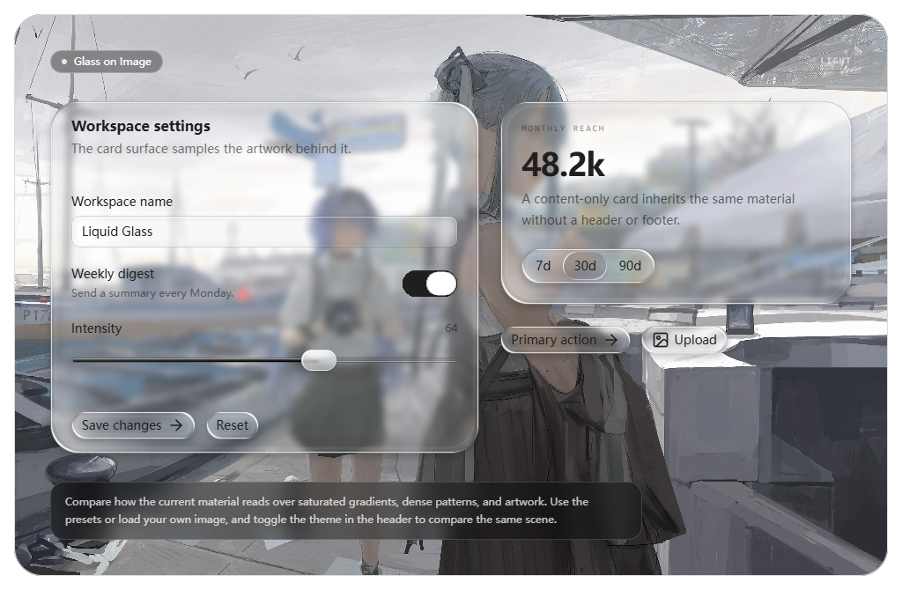

<picture>
  <source media="(prefers-color-scheme: dark)" srcset=".github/assets/surface-lab-dark.png">
  <source media="(prefers-color-scheme: light)" srcset=".github/assets/surface-lab-light.png">
  
</picture>

<div align="center">

[![npm version][npm-version-src]][npm-version-href]
[![npm downloads][npm-downloads-src]][npm-downloads-href]
[![License][license-src]][license-href]
[![React][react-src]][react-href]
[![Tailwind CSS][tailwind-src]][tailwind-href]

</div>

`@xingxingmofashu/ui` is a collection of accessible, typed [React](https://react.dev)
components with a Liquid Glass visual style, built with
[Tailwind CSS](https://tailwindcss.com) and
[Tailwind Variants](https://www.tailwind-variants.org). Glass surfaces, rim
highlights, and inner shadows are drawn entirely with CSS.

The package ships eighteen components: Accordion, Alert Dialog, Button, Card,
Checkbox, Dialog, Drawer, Input, Popover, Progress, Radio Group, Scroll Area,
Slider, Switch, Tabs, Toast, Toggle, and Toggle Group.

> [!NOTE]
> Requires React 19, React DOM 19, Tailwind CSS 4, Node.js 22+, and an
> ESM-capable bundler. `Card` is server-safe; the interactive components are
> client components.

## Documentation

- [English](https://xingxingmofashu.github.io/ui/docs/en/get-started/introduction)
- [简体中文](https://xingxingmofashu.github.io/ui/docs/zh/get-started/introduction)
- [llms.txt](https://xingxingmofashu.github.io/ui/llms.txt) — a compact index for
  language models and agents
- [llms-full.txt](https://xingxingmofashu.github.io/ui/llms-full.txt) — every
  guide and component page in one file

## Installation

```bash [pnpm]
pnpm add @xingxingmofashu/ui
```

```bash [yarn]
yarn add @xingxingmofashu/ui
```

```bash [npm]
npm install @xingxingmofashu/ui
```

```bash [bun]
bun add @xingxingmofashu/ui
```

Add the package styles to your Tailwind CSS entry:

```css [app.css]
@import "tailwindcss";
@import "@xingxingmofashu/ui";
```

The package root resolves to `dist/index.css` through its `style` export. The
stylesheet includes its own Tailwind source scan, so component utilities are
generated without an extra `@source` directive.

### Glass presets

Import the optional preset stylesheet:

```css [app.css]
@import "@xingxingmofashu/ui/plugins/glass-preset/preset.css";
```

Then switch the shared glass material with `data-glass` on the root or any
container:

```html
<html data-glass="thin">
<section data-glass="thick">...</section>
```

`thin` is the clearest, `regular` is the default, and `thick` is the most
readable over busy imagery. Presets only override shared CSS variables. Without
`preset.css`, the main stylesheet still uses the `regular` material.

The optional React plugin manages the attribute and persistence:

```tsx
import {
  GlassPresetProvider,
  GlassPresetScope,
  GlassPresetScript,
} from "@xingxingmofashu/ui/plugins/glass-preset";

// In <head>, before React hydrates.
<GlassPresetScript storageKey="app-glass" />;

// Around the application.
<GlassPresetProvider storageKey="app-glass">
  {children}
</GlassPresetProvider>;

// Or scope one container without changing the global preset.
<GlassPresetScope preset="thick">{children}</GlassPresetScope>;
```

The provider writes `data-glass` to `<html>` and exposes
`useGlassPreset()`. Pass `preset` and `onPresetChange` for controlled state, or
`defaultPreset` for an uncontrolled initial value.

## Usage

```tsx
import { Button, Card, Switch } from "@xingxingmofashu/ui";

export function Example() {
  return (
    <Card title="Liquid glass" description="CSS-only frosted panel.">
      <Switch label="Notifications" defaultChecked />
      <Button label="Continue" />
    </Card>
  );
}
```

### Deep imports

Import a single component or theme recipe without going through the package
root:

```tsx
import { Button } from "@xingxingmofashu/ui/components/button";
import buttonTheme from "@xingxingmofashu/ui/theme/button";
```

Toast hooks live under `@xingxingmofashu/ui/composables`.

## Development

```bash
pnpm install
pnpm build           # build dist with unbuild
pnpm lint            # lint with oxlint
pnpm test            # run the Vitest suite
pnpm test:visual     # run the Playwright visual regression suite
pnpm test:visual:update  # refresh the Surface Lab screenshots
pnpm typecheck       # typecheck the package
pnpm docs:dev        # docs site on http://localhost:3001
pnpm playground:dev  # component playground on http://localhost:3002
```

The documentation site lives in `docs/` and the playground lives in
`playground/`; both import the package from the workspace.

## Contribution

Found a bug? [Open an issue](https://github.com/xingxingmofashu/ui/issues) with
a reproduction. Before opening a pull request, run `pnpm lint`, `pnpm test`, and
`pnpm typecheck`.

> [!TIP]
> [`AGENTS.md`](https://github.com/xingxingmofashu/ui/blob/main/AGENTS.md)
> describes the component, theme, test, and documentation conventions used in
> this repository.

## Credits

- [Tailwind CSS](https://tailwindcss.com)
- [Tailwind Variants](https://www.tailwind-variants.org)

## License

Licensed under the [MIT license](https://github.com/xingxingmofashu/ui/blob/main/LICENSE).

<!-- Badges -->

[npm-version-src]: https://img.shields.io/npm/v/@xingxingmofashu/ui.svg?style=flat&colorA=18181B&colorB=52525B
[npm-version-href]: https://www.npmjs.com/package/@xingxingmofashu/ui
[npm-downloads-src]: https://img.shields.io/npm/dm/@xingxingmofashu/ui.svg?style=flat&colorA=18181B&colorB=52525B
[npm-downloads-href]: https://npm.chart.dev/@xingxingmofashu/ui
[license-src]: https://img.shields.io/github/license/xingxingmofashu/ui.svg?style=flat&colorA=18181B&colorB=52525B
[license-href]: https://github.com/xingxingmofashu/ui/blob/main/LICENSE
[react-src]: https://img.shields.io/badge/React-19-18181B?style=flat&logo=react&logoColor=white
[react-href]: https://react.dev
[tailwind-src]: https://img.shields.io/badge/Tailwind_CSS-4-18181B?style=flat&logo=tailwindcss&logoColor=white
[tailwind-href]: https://tailwindcss.com
